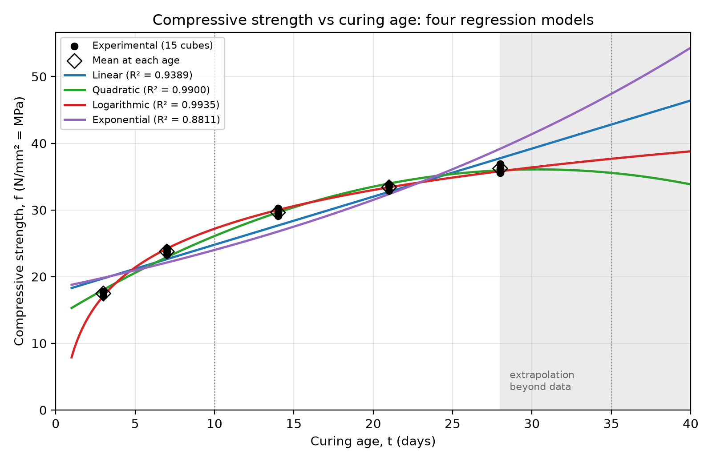
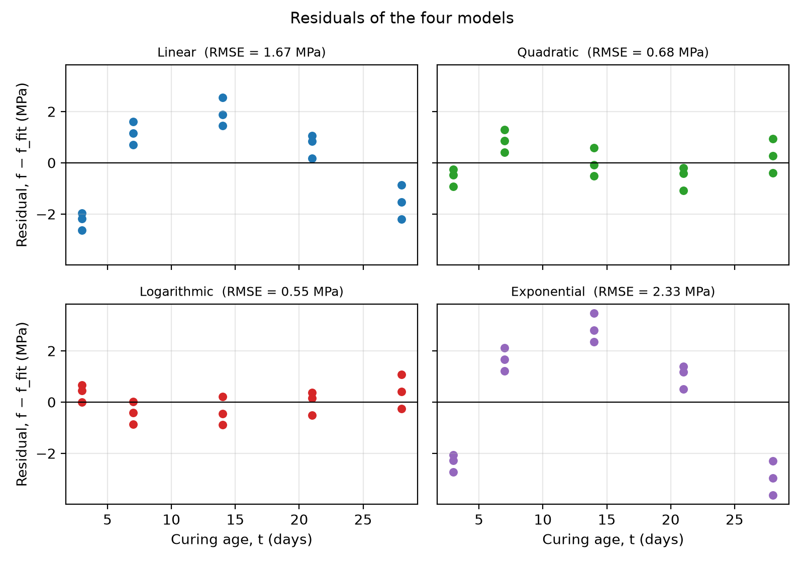
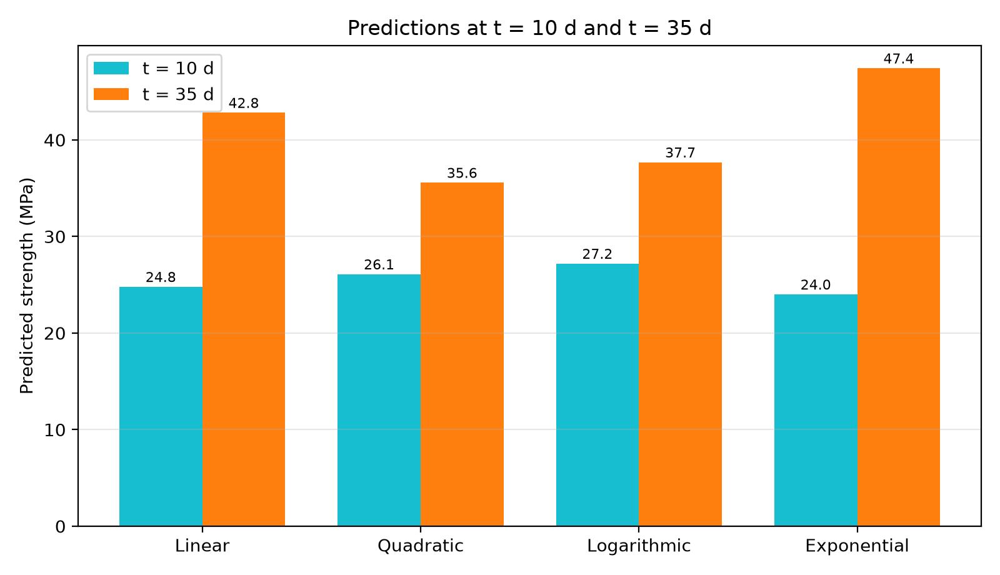

# Regression and Prediction of Concrete Strength (Q1.1)

VIBE CIVIL 2000 · AI/ML for Sustainable Infrastructure Systems · Ranvir Kumar, 23CE36016

This program fits Linear, Quadratic, Logarithmic and Exponential regression models to the concrete cube
test data (curing age vs compressive strength), compares them, and predicts strength at t = 10 and 35 days.

## Files

| File | Purpose |
|---|---|
| `regression_analysis.py` | Main program (data, four models, metrics, plots) |
| `verify.py` | Optional independent check using plain Python formulas (no numpy) |
| `Results/` | Output of the program: `fig1_fits.png`, `fig2_residuals.png`, `fig3_predictions.png`, `results.json` |
| `Q1_1_Concrete_Strength_Regression_Report.*` | Full report (problem, prompts, code, output, interpretation) |
| `README.md` | This file |

## What the program produces

All outputs are saved in the **same folder as the script** (in this repository the generated files are kept in the `Results/` folder):

- `fig1_fits.png` – data and the four fitted curves
- `fig2_residuals.png` – residual plots
- `fig3_predictions.png` – predictions at t = 10 d and 35 d
- `results.json` – all coefficients, metrics and predictions
- A summary printed in the terminal (equations, R², RMSE, predictions)

Plots are saved as image files, so no plot window opens.

## Results

### Data (150 mm cubes, strength = load × 1000 / 22,500, in MPa)

| Age (d) | Cube 1 | Cube 2 | Cube 3 | Mean | Mean / f28 |
|---|---|---|---|---|---|
| 3 | 17.11 | 17.56 | 17.78 | 17.48 | 0.48 |
| 7 | 23.33 | 23.78 | 24.22 | 23.78 | 0.66 |
| 14 | 29.11 | 29.56 | 30.22 | 29.63 | 0.82 |
| 21 | 32.89 | 33.56 | 33.78 | 33.41 | 0.92 |
| 28 | 35.56 | 36.22 | 36.89 | 36.22 | 1.00 |

### Fitted models (f in MPa, t in days)

| Model | Equation | R² | Adj. R² | RMSE (MPa) | CV-RMSE (MPa) |
|---|---|---|---|---|---|
| Linear | f = 17.577 + 0.7210 t | 0.9389 | 0.9342 | 1.672 | 3.206 |
| Quadratic | f = 13.862 + 1.4639 t − 0.02411 t² | 0.9900 | 0.9884 | 0.675 | 1.998 |
| **Logarithmic** | **f = 7.904 + 8.3746 ln t** | **0.9935** | **0.9930** | **0.545** | **0.894** |
| Exponential | f = 18.278 exp(0.02723 t) | 0.8811 | 0.8720 | 2.332 | 5.015 |

CV-RMSE is the leave-one-age-out cross-validation error (all 3 cubes of one age held out, model refitted).

### Predictions

| Model | f(10 d) MPa | f(35 d) MPa |
|---|---|---|
| Linear | 24.79 | 42.81 |
| Quadratic | 26.09 | 35.57 |
| **Logarithmic** | **27.19** | **37.68** |
| Exponential | 24.00 | 47.41 |

- **t = 10 d** is an interpolation (between the 7 d and 14 d tests), so about **27.2 MPa** is reliable.
- **t = 35 d** is an extrapolation beyond the tested ages (3 to 28 d). Logarithmic gives about **37.7 MPa** (+4% over the 28 d mean of 36.2 MPa); the four models range from 35.6 to 47.4 MPa, so treat it as indicative only.

### Figures



*Fig. 1: Experimental data and the four fitted curves (shaded area = extrapolation beyond 28 d).*



*Fig. 2: Residuals. Linear and exponential show systematic curved patterns; quadratic and logarithmic are small and mostly random.*



*Fig. 3: Predicted strength at t = 10 d and t = 35 d for each model.*

All numerical values are also stored in [`Results/results.json`](Results/results.json).

### Interpretation (summary)

- **Best model: logarithmic.** Highest adjusted R², lowest RMSE and by far the lowest cross-validation error, with only two parameters. It also matches the physics: rapid early hydration, then a decreasing rate of gain.
- **Quadratic** fits the tested range well but turns downward at about 30 d (vertex t = 30.4 d), so its 35 d value is below the 28 d value. It should not be used for extrapolation.
- **Linear** and **exponential** are structurally wrong for this behaviour (curved residual patterns). Exponential growth is the worst, because concrete strength gain decelerates.
- **Validation:** units and magnitudes checked (385 kN gives 17.11 MPa; 3 d and 7 d strengths are 48% and 66% of the 28 d strength); results reproduced by the independent `verify.py`; method consistent with the course booklets and IS 456:2000 (28 d strength of 150 mm cubes is the design basis).

## Requirements

- Python 3.9 or newer (3.10+ recommended)
- Packages: `numpy`, `scipy`, `matplotlib`

`verify.py` needs only Python (no extra packages).

---

## Option A: Run in Windows PowerShell

1. **Check Python is installed.** Open PowerShell and run:
   ```powershell
   python --version
   ```
   If this fails, try `py --version`. If both fail, install Python from https://www.python.org/downloads/
   and tick **"Add python.exe to PATH"** during installation. Then reopen PowerShell.
   (If `py` works but `python` does not, use `py` in place of `python` in every command below.)

2. **Go to the folder containing the script.** Replace the path with your own:
   ```powershell
   cd "C:\Users\YourName\Documents\ConcreteRegression"
   ```
   Check that the file is there:
   ```powershell
   dir
   ```

3. **(Recommended) Create and activate a virtual environment:**
   ```powershell
   python -m venv venv
   .\venv\Scripts\Activate.ps1
   ```
   If PowerShell says *"running scripts is disabled on this system"*, run this once and try again:
   ```powershell
   Set-ExecutionPolicy -Scope CurrentUser -ExecutionPolicy RemoteSigned
   ```
   When active, the prompt starts with `(venv)`.

4. **Install the packages:**
   ```powershell
   python -m pip install --upgrade pip
   python -m pip install numpy scipy matplotlib
   ```

5. **Run the program:**
   ```powershell
   python regression_analysis.py
   ```

6. **Open the results.** The terminal prints the table of models and predictions. To view the figures:
   ```powershell
   start fig1_fits.png
   start fig2_residuals.png
   start fig3_predictions.png
   ```

7. **(Optional) Run the independent check:**
   ```powershell
   python verify.py
   ```
   Its R², RMSE, f(10 d) and f(35 d) values should match the main program.

---

## Option B: Run in VS Code

1. **Install the tools** (once): VS Code (https://code.visualstudio.com), Python, and the **Python extension**
   by Microsoft (Extensions icon on the left sidebar, search "Python", click Install).

2. **Open the folder.** `File > Open Folder...` and choose the folder containing `regression_analysis.py`.
   Open the file from the Explorer panel.

3. **Select the interpreter.** Press `Ctrl+Shift+P`, type **Python: Select Interpreter**, and choose your
   Python (or the `venv` one if you created it).

4. **Open the terminal inside VS Code:** `Terminal > New Terminal` (or ``Ctrl+` ``). It opens in the project folder.

5. **Install the packages** in that terminal:
   ```powershell
   python -m pip install numpy scipy matplotlib
   ```
   (If you made a virtual environment, activate it first with `.\venv\Scripts\Activate.ps1`.)

6. **Run the program** using either method:
   - Click the **Run** triangle at the top right of the editor, or
   - Type in the terminal:
     ```powershell
     python regression_analysis.py
     ```

7. **View the figures:** the three `.png` files appear in the Explorer panel. Click one to preview it in VS Code.

---

## Expected output (check your run against this)

| Model | Equation (f in MPa, t in days) | R² | f(10 d) MPa | f(35 d) MPa |
|---|---|---|---|---|
| Linear | f = 17.577 + 0.7210 t | 0.9389 | 24.79 | 42.81 |
| Quadratic | f = 13.862 + 1.4639 t − 0.02411 t² | 0.9900 | 26.09 | 35.57 |
| Logarithmic | f = 7.904 + 8.3746 ln t | 0.9935 | 27.19 | 37.68 |
| Exponential | f = 18.278 exp(0.02723 t) | 0.8811 | 24.00 | 47.41 |

The first printed line should read `Area = 22500 mm^2; 385 kN -> 17.111 MPa`.

## Troubleshooting

| Problem | Fix |
|---|---|
| `'python' is not recognized` | Install Python with "Add to PATH", or use `py` instead of `python` |
| `ModuleNotFoundError: No module named 'numpy'` (or scipy / matplotlib) | Run `python -m pip install numpy scipy matplotlib` in the same terminal/interpreter you use to run the script |
| `Activate.ps1 cannot be loaded because running scripts is disabled` | Run `Set-ExecutionPolicy -Scope CurrentUser -ExecutionPolicy RemoteSigned`, then activate again |
| VS Code runs a different Python than the terminal | `Ctrl+Shift+P`, **Python: Select Interpreter**, pick the one where you installed the packages |
| Figures not found | They are saved next to `regression_analysis.py`, not in the folder where you opened PowerShell from (move them into `Results/` if you want them to match this README) |
| `PermissionError` when saving | Close any image viewer holding the old `.png` open, or move the folder out of OneDrive/read-only locations |

## Changing the data

Edit the `age` and `load` arrays near the top of `regression_analysis.py` (section "1. DATA") and the
prediction ages in `T_PRED` (and the `pred10` / `pred35` calls if you want different times), then run again.
